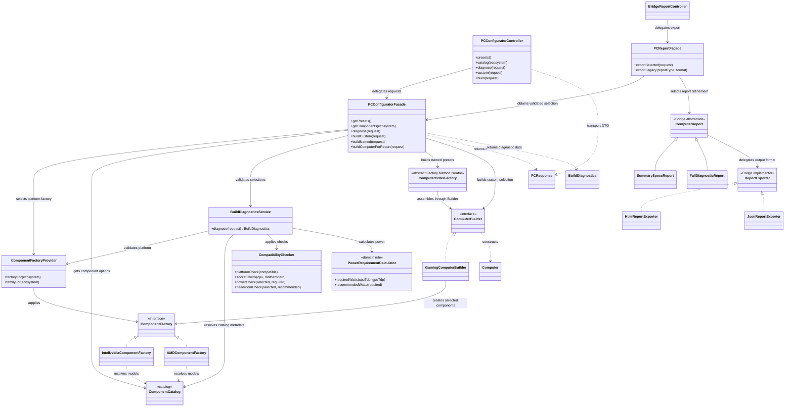

# PC Build Studio — UML

The diagram reflects the implemented Assignment #4 configuration facade, diagnostic collaborators, Assignment 2 construction patterns, and the separate report facade.

The stress-test demonstration is intentionally a different workflow. Its `StressTestFacadeController` uses `PCConfiguratorFacade` for validated construction, then `SystemStressTestFacade` coordinates the simulated benchmark, rendering, and thermal subsystems.
